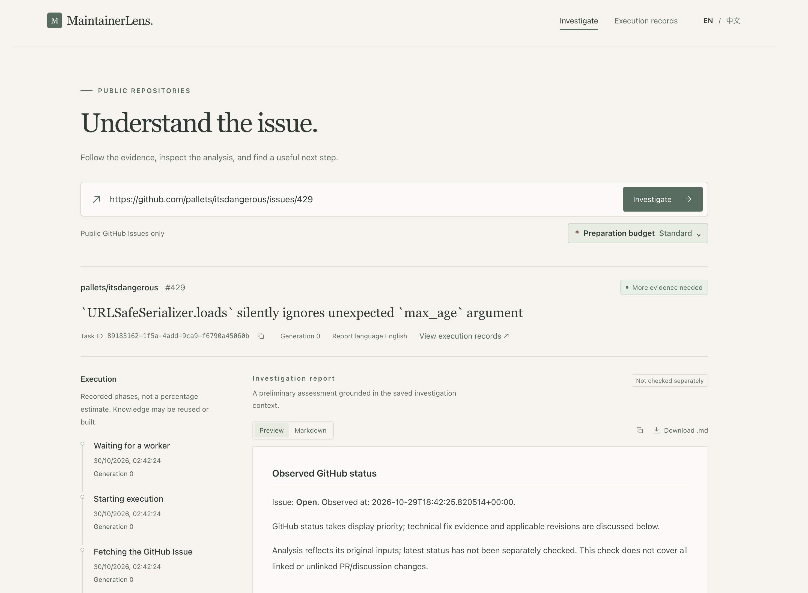
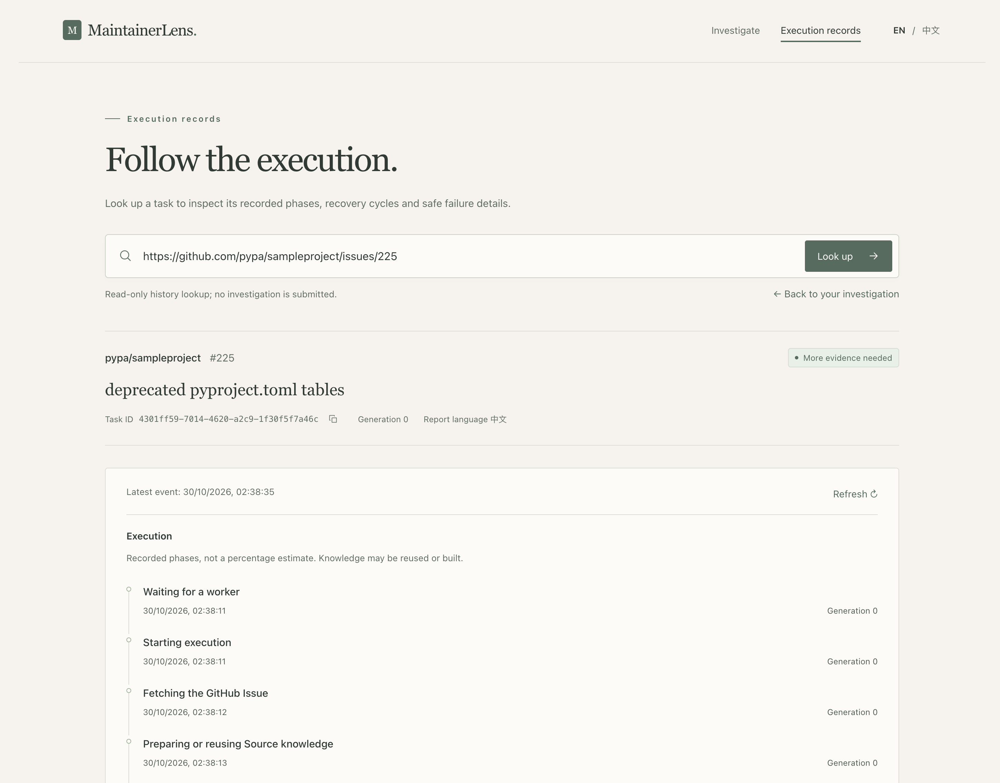
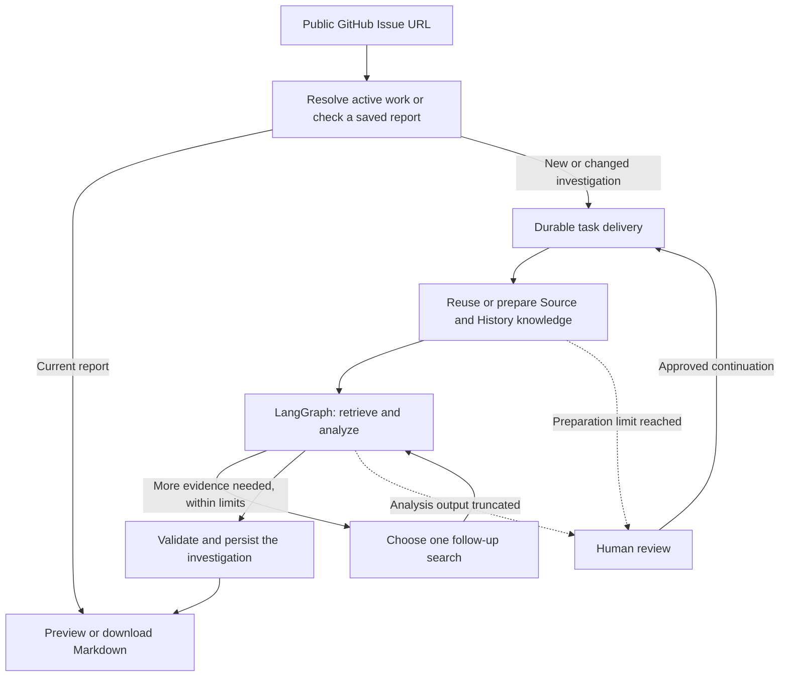

<div align="center">

# MaintainerLens

### Investigate the Issue. Follow the evidence.

Turn a public GitHub Issue URL into a source-grounded investigation report—with a visible execution trail.

**English** · [**简体中文 →**](README.zh-CN.md)

[Quick start](#quick-start) · [How it works](#how-it-works) · [Documentation](#documentation) · [Roadmap](docs/ROADMAP.md)

**Self-hosted · Read-only · English / 中文 · Apache-2.0**

</div>

---

MaintainerLens brings repository source, documentation and historical Issues/PRs
into one bounded investigation workflow. Submit an Issue, watch its progress,
and receive a Markdown report with findings, hypotheses, open questions and
links back to the evidence used by the analysis.

It gives maintainers and developers a starting point for triage: what the code
shows, what earlier discussions establish, and what still needs checking.
V1 investigates; it does not edit repositories or submit fixes.



## What you get

| Capability | In practice |
| --- | --- |
| **Source + History retrieval** | Reuse compatible knowledge, or prepare missing source/documentation and Issue/PR/comment knowledge automatically. |
| **Bounded agent investigation** | LangGraph retrieves, analyzes and selects follow-up searches within explicit round and time limits. |
| **Traceable reports** | Inspect commit-pinned source lines, historical references and actual analysis excerpts. Preview, copy or download Markdown. |
| **Durable execution** | Transactional delivery, task leases and persisted Graph checkpoints support controlled recovery. |
| **Reuse with freshness checks** | Repeated URLs resolve active work, reuse a current report or queue an updated investigation. |
| **On-demand review** | Approve a larger preparation/output allowance, accept an eligible complete stage analysis, or reject the task. |
| **Visible operations** | Follow recorded phases and look up task history by Task ID or Issue URL. |

<details>
<summary><strong>See the execution-records workspace</strong></summary>



The records page is read-only. Returning to the investigation page preserves
its current workspace so you can copy the Task ID or continue reading the report.

</details>

## How it works



PostgreSQL owns tasks, knowledge, checkpoints and results. RabbitMQ carries
work between the independent API, Outbox Dispatcher and Worker. Source evidence
is tied to an immutable commit; a valid citation remains distinct from a
verified root cause. [Explore the architecture →](docs/ARCHITECTURE.md)

## Quick start

**Requirements:** Git, Docker with Compose v2, and working Chat + Embedding
API configurations. Host Python and Node.js are unnecessary for Docker use.

```bash
git clone https://github.com/paulakkda-labs/maintainer-lens.git
cd maintainer-lens
cp .env.example .env
```

Edit `.env` before starting:

- Replace the PostgreSQL and RabbitMQ example credentials.
- Set `LLM_BASE_URL`, `LLM_MODEL_NAME` and `LLM_API_KEY`.
- Set `EMBEDDING_BASE_URL`, `EMBEDDING_MODEL`, `EMBEDDING_API_KEY` and matching `EMBEDDING_DIMENSIONS`.
- Optionally set `GITHUB_TOKEN` for GitHub API ingestion.

Use compatible providers with JSON output, function calling and embedding
support; see [model requirements and configuration](docs/CONFIGURATION.md#model-protocol-requirements).
Requests can incur provider charges. Keys stay on the server.

```bash
docker compose up -d --build
```

Open **[http://127.0.0.1:8000](http://127.0.0.1:8000)**, paste a public Issue URL,
and select **Small** for a first small-repository trial. The UI starts in English;
choose 中文 before submission for a Chinese report.

Compose starts **five services** and runs migrations automatically through a
one-shot `migrate` service. No manual Source UUID or separate frontend server is
needed. [Installation, upgrades and Docker commands →](docs/INSTALLATION.md)

## Use it

1. Submit an Issue URL and choose a knowledge-preparation budget.
2. Follow the Task ID and recorded execution phases.
3. Read the report in preview, inspect its evidence, or download `.md`.
4. Use **Execution records** to inspect earlier tasks by ID or URL.

Insufficient evidence is a completed investigation with declared gaps, not
necessarily a failed task. Budget review and processing failures are displayed
explicitly. Repeating a URL does not approve a pending review.
[Web, API and review guide →](docs/WEB_INTERFACE.md)

## Coverage and boundaries

- **Syntax-aware:** Python, JavaScript, TypeScript, Go and Java; heading-aware Markdown.
- **Text retrieval:** selected Rust, C/C++, C#, Ruby, Shell, HTML/CSS and configuration/document formats.
- **V1 scope:** public repositories, read-only investigation, English/Chinese reports. No accounts, private-repository access, conversational memory or automatic code changes.
- **Bounded coverage:** allowlists, preparation budgets and selected excerpts limit what is examined. Findings and suggested actions still need developer judgment.
- **Deployment:** the bundled localhost stack has no authentication or user isolation; it is not configured for unrestricted public hosting.

[Exact extensions and limitations →](docs/SUPPORTED_LANGUAGES.md)

## Documentation

| Start here | Details |
| --- | --- |
| [Installation & operations](docs/INSTALLATION.md) | Fresh setup, service commands, upgrades and host-mode development |
| [Configuration](docs/CONFIGURATION.md) | Models, credentials, custom IPs/ports and preparation budgets |
| [Using the application](docs/WEB_INTERFACE.md) | Reports, languages, URL reuse, API requests and human decisions |
| [Architecture & technology](docs/ARCHITECTURE.md) | Components, transactions, retrieval, recovery and trust boundaries |
| [Troubleshooting](docs/TROUBLESHOOTING.md) | Task lookup, error details and Docker logs |
| [Development & tests](docs/DEVELOPMENT.md) | Local development, offline/integration tests and contributing |
| [Roadmap](docs/ROADMAP.md) | Implemented V1 scope and proposed V2 directions |

[All documentation](docs/README.md) · [Report evaluation](docs/REPORT_QUALITY.md) · [Architecture decisions](docs/ADR/README.md)

## License

[Apache License 2.0](LICENSE).
