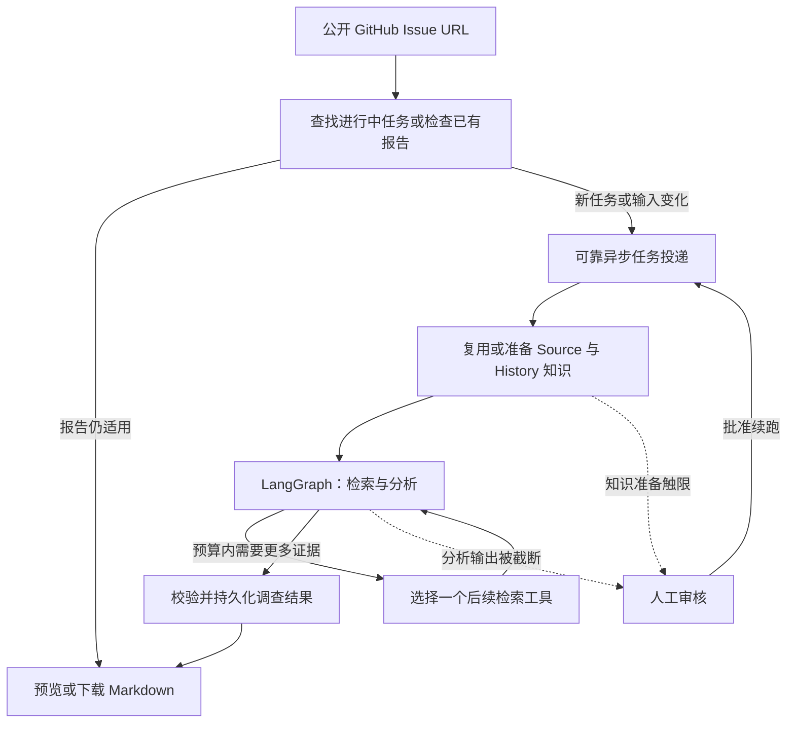

<div align="center">

# MaintainerLens

### 分析 Issue，让每条结论有据可查。

输入公开 GitHub Issue URL，获得附带源码、历史讨论与执行记录的调查报告。

[**English →**](README.md) · **简体中文**

[快速启动](#快速启动) · [执行流程](#执行流程) · [文档导航](#文档导航) · [路线图](docs/ROADMAP.md)

**自主部署 · 只读调查 · 中英文报告 · Apache-2.0**

</div>

---

MaintainerLens 将仓库源码、文档和历史 Issue/PR 纳入同一条有边界的调查流程。
提交 Issue 后，可以查看执行进度，获得包含调查结论、待验证假设、未解决问题和证据引用的 Markdown 报告。

它为维护者和开发者提供 Issue 分析的起点：当前代码展示了什么，历史讨论说明了什么，下一步还需要检查什么。
V1 专注调查，不会自动修改仓库或提交修复。


## 核心能力

| 能力 | 实际用途 |
| --- | --- |
| **Source + History 双路检索** | 复用兼容知识；缺少时自动准备源码/文档和 Issue、PR、评论知识。 |
| **有边界的 Agent 调查** | LangGraph 完成检索、分析和后续工具选择，受轮数、时间等限制约束。 |
| **可追溯报告** | 查看固定 commit 的源码行、历史引用及实际分析摘录；支持预览、复制和 Markdown 下载。 |
| **持久化工作流** | 事务消息投递、任务租约和 Graph checkpoint 支持受控恢复。 |
| **URL 复用与新鲜度检查** | 重复提交时查找进行中的任务、复用当前报告，或排队重新调查。 |
| **按需人工介入** | 批准提高知识准备/输出额度、接受符合条件的完整阶段分析，或拒绝结束。 |
| **执行记录与排障** | 查看阶段进度，通过 Task ID 或 Issue URL 查询任务历史。 |

<details>
<summary><strong>查看调查步骤与执行记录页面</strong></summary>


执行记录页只读查询；返回调查主页时保留当前工作区，方便复制 Task ID 或继续查看报告。

</details>

## 执行流程



PostgreSQL 保存任务、知识、checkpoint 和结果；RabbitMQ 在独立的 API、Outbox Dispatcher 与 Worker 之间传递工作。
源码证据定位到固定 commit。引用可追溯，并不等于根因已被独立验证。
[了解架构与技术栈 →](docs/ARCHITECTURE.md)

## 快速启动

**准备条件：** Git、带 Compose v2 的 Docker，以及可用的 LLM 和 Embedding API 配置。
通过 Docker 启动，无需在宿主机安装 Python 或 Node.js。

```bash
git clone https://github.com/paulakkda-labs/maintainer-lens.git
cd maintainer-lens
cp .env.example .env
```

启动前编辑 `.env`：

- 修改 PostgreSQL、RabbitMQ 的示例用户名和密码。
- 填写 `LLM_BASE_URL`、`LLM_MODEL_NAME`、`LLM_API_KEY`。
- 填写 `EMBEDDING_BASE_URL`、`EMBEDDING_MODEL`、`EMBEDDING_API_KEY`，并设置匹配的 `EMBEDDING_DIMENSIONS`。
- 可选配置 `GITHUB_TOKEN`，用于 GitHub API 数据获取。

模型服务需兼容所用的 JSON 输出、Function Calling 和 Embedding 协议，具体见[模型要求与配置](docs/CONFIGURATION.md#model-protocol-requirements)。
模型请求可能产生费用；API Key 保留在服务端。

```bash
docker compose up -d --build
```

打开 **[http://127.0.0.1:8000](http://127.0.0.1:8000)**，输入公开 Issue URL。
第一次建议选择小仓库和 **Small** 档。页面默认英文；提交前切换右上角“中文”，即可请求中文报告。

Compose 启动 **五个常驻服务**，并通过一次性的 `migrate` 服务自动建表/升级。
无需手工准备 Source UUID，也不用额外启动前端服务。
[完整安装、升级与 Docker 命令 →](docs/INSTALLATION.md)

## 基本使用

1. 输入 Issue URL，选择知识准备预算档位。
2. 查看 Task ID 与记录的执行阶段。
3. 在预览中阅读报告，检查证据，或下载 `.md`。
4. 进入“执行记录”，通过 Task ID 或 Issue URL 查询历史任务。

“证据不足”可以是正常完成的调查，报告会说明缺口；需要人工审核或执行失败时，页面会展示相应状态和原因。
重复提交 URL 不会自动批准待审核任务。
[页面、API 与人工审核说明 →](docs/WEB_INTERFACE.md)

## 支持范围与限制

- **语法感知切片：** Python、JavaScript、TypeScript、Go、Java；Markdown 支持按标题组织切片。
- **文本检索：** 部分 Rust、C/C++、C#、Ruby、Shell、HTML/CSS 及配置、文档格式。
- **V1 范围：** 公开仓库、只读调查、中英文报告；不含账户体系、私有仓库、连续对话记忆或自动代码修改。
- **覆盖边界：** 文件白名单、知识准备预算和实际选取片段限制了可见范围；报告结论与操作建议仍需开发者判断。
- **部署边界：** 默认绑定本机地址，没有身份认证和用户隔离，不适合直接暴露为公开互联网服务。

[完整后缀列表与限制 →](docs/SUPPORTED_LANGUAGES.md)

## 文档导航

| 文档 | 内容 |
| --- | --- |
| [安装与运行](docs/INSTALLATION.md) | 全新安装、常用服务命令、升级及宿主机开发模式 |
| [配置详解](docs/CONFIGURATION.md) | 模型、数据库/消息队列凭据、自定义 IP/端口与预算 |
| [使用指南](docs/WEB_INTERFACE.md) | 报告、语言、URL 复用、API 与人工操作 |
| [架构与技术栈](docs/ARCHITECTURE.md) | 模块职责、事务、检索、恢复和信任边界 |
| [排障指南](docs/TROUBLESHOOTING.md) | 根据 URL/Task ID 查看状态、失败原因与 Docker 日志 |
| [开发与测试](docs/DEVELOPMENT.md) | 本地开发、离线/集成测试与贡献方式 |
| [路线图](docs/ROADMAP.md) | V1 已实现能力与 V2 规划方向 |

详细技术文档目前以英文维护。[全部文档](docs/README.md) · [报告评估](docs/REPORT_QUALITY.md) · [架构决策](docs/ADR/README.md)

## 开源许可

[Apache License 2.0](LICENSE)。
