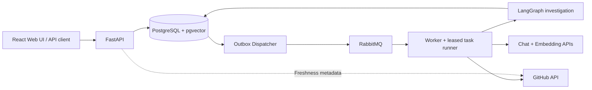
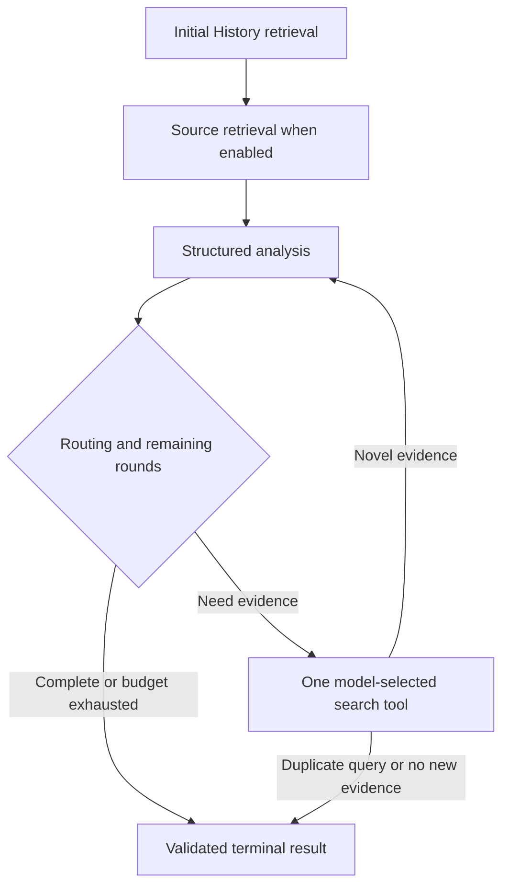

# Architecture

[Documentation](README.md) · [Configuration](CONFIGURATION.md) · [Architecture decisions](ADR/README.md)

MaintainerLens is an asynchronous, read-only investigation application for public
GitHub Issues. The Web UI submits work and observes durable state; independent
backend processes prepare knowledge and run a bounded LangGraph investigation.

## System overview

Five services remain running: PostgreSQL, RabbitMQ, API, Dispatcher and Worker.
An additional one-shot migration service runs Alembic before the applications
start. Docker builds the React/TypeScript/Vite assets and FastAPI serves them
from the same origin. Node is a build dependency, not another runtime service.
There is no Redis dependency in V1.

## Technology and responsibilities

| Layer | Technology | Responsibility |
| --- | --- | --- |
| Web | React, TypeScript, Vite, react-markdown | Investigation/records workspaces, polling and safe report preview |
| HTTP | Python 3.12+, FastAPI, Pydantic, HTTPX | Validated contracts, intake, readback and provider boundaries |
| Workflow | LangGraph | Retrieval/analysis nodes and bounded conditional follow-up |
| Persistence | PostgreSQL 17, pgvector, SQLAlchemy async, asyncpg | Task authority, knowledge, Graph progress and results |
| Delivery | RabbitMQ 4.2, aio-pika, transactional Outbox | Durable at-least-once work delivery |
| Lifecycle | asyncio, AsyncExitStack, claims and leases | Cancellation, cleanup and stale-worker fencing |
| Operations | Alembic, Docker Compose, Ruff, pytest, GitHub Actions | Migrations, deployment and verification |

PostgreSQL is authoritative. RabbitMQ carries work signals; it is not the task
status database. LangGraph checkpoints save node progress; they do not replace
task ownership, delivery acknowledgments or human decisions.

## Module navigation map

| Area | Main entry points | Responsibility |
| --- | --- | --- |
| HTTP intake/readback | [routes](../src/maintainer_lens/api/routes/investigations.py), [contracts](../src/maintainer_lens/schemas/investigation_contracts.py) | Validate requests, resolve URL intent and return durable state |
| Web | [workspace](../web/src/App.tsx), [polling](../web/src/useTask.ts), [asset serving](../src/maintainer_lens/web.py) | Same-origin UI, local translation, retained task references |
| URL resolution | [resolver](../src/maintainer_lens/services/investigation_url_reuse.py), [freshness](../src/maintainer_lens/services/investigation_freshness.py) | Active-task deduplication, scoped report reuse and controlled user recovery |
| Submission/delivery | [submission](../src/maintainer_lens/services/investigation_submission.py), [Dispatcher](../src/maintainer_lens/services/outbox_dispatcher.py), [handler](../src/maintainer_lens/messaging/handler.py) | Atomic Task/Outbox creation, confirmed publication and retry routing |
| Task ownership | [runner](../src/maintainer_lens/investigation_runner.py), [task DB](../src/maintainer_lens/db/investigation_tasks.py) | Claim token, lease renewal, guarded task transitions |
| Worker assembly | [Worker](../src/maintainer_lens/worker.py), [execution profile](../src/maintainer_lens/services/investigation_configuration.py) | Assemble clients, retrievers, analyzer and existing Runner |
| Business processing | [processor](../src/maintainer_lens/services/investigation_processor.py), [Issue snapshot](../src/maintainer_lens/services/issue_investigator.py) | Load/freeze execution input and persist results under ownership |
| Knowledge preparation | [preparer](../src/maintainer_lens/services/investigation_preparation.py), [Source indexing](../src/maintainer_lens/services/repository_indexing.py), [History pipeline](../src/maintainer_lens/services/repository_history_pipeline.py) | Prepare or reuse compatible repository knowledge |
| Source selection | [index boundary](../src/maintainer_lens/services/investigation_source_index.py), [retrieval adapters](../src/maintainer_lens/agents/investigation/retrieval.py) | Check repository/index/model identity and retrieve evidence |
| Graph application | [execution](../src/maintainer_lens/services/investigation_execution.py), [composition](../src/maintainer_lens/agents/investigation_graph.py), [nodes](../src/maintainer_lens/agents/investigation/) | Input/result validation, full deadline, edges and node-local work |
| Model analysis/tools | [analysis adapter](../src/maintainer_lens/agents/investigation_analysis.py), [tool protocol](../src/maintainer_lens/agents/investigation/tool_calling.py) | Structured output, one schema correction and whitelisted tool requests |
| Checkpoints | [resume service](../src/maintainer_lens/services/investigation_checkpoint_execution.py), [Saver](../src/maintainer_lens/agents/investigation/checkpointing.py), [store](../src/maintainer_lens/db/investigation_checkpoints.py) | Frozen Run identity, snapshots and pending node writes |
| Human review | [review service](../src/maintainer_lens/services/investigation_review.py), [review routes](../src/maintainer_lens/api/routes/investigation_reviews.py) | Pause, validate explicit decisions and resume idempotently |
| Results/progress | [result store](../src/maintainer_lens/db/investigation_results.py), [renderer](../src/maintainer_lens/services/investigation_report.py), [progress](../src/maintainer_lens/services/investigation_progress.py) | Validated artifacts, derived Markdown and safe committed events |
| Diagnostics/evaluation | [logging](../src/maintainer_lens/core/investigation_logging.py), [evaluation](../src/maintainer_lens/evaluation/report_quality.py) | Safe diagnostics and evidence observations, not semantic certification |

## Execution flows

### HTTP to Worker

1. `POST /investigations/from-url` validates public Issue identity, language and
   preparation profile. URL arbitration resolves active work, saved results or a new task.
2. New work commits an `InvestigationTask` and Outbox event in the same transaction.
3. Dispatcher claims Outbox events and publishes with RabbitMQ publisher confirms.
4. Worker receives the message; the original Runner atomically claims the Task
   with a token and expiring lease, then maintains ownership while processing.
5. Without an existing frozen Run, processing obtains/commits the GitHub Issue
   snapshot, prepares or reuses knowledge, binds the effective Source UUID, and
   freezes the investigation input and execution configuration.
6. The Graph retrieves, analyzes and performs bounded follow-up work. Checkpoint
   callbacks commit node progress under the current claim/lease.
7. The processor validates and commits the result with fencing. The Runner then
   commits success. The consumer acknowledges only after its awaited handler returns.
8. GET returns the durable task and, when succeeded, analysis and derived Markdown.

The lower-level `POST /investigations` also exists for repository/Issue-number
submission and explicit knowledge. It does not implicitly provide the URL path's
automatic knowledge preparation. Ordinary users should use the URL workspace.

### Knowledge preparation and retrieval

Source preparation observes the default branch commit, pins tree/blob identity,
filters supported files, chunks text and creates embeddings. A versioned index
is reusable only when its repository, commit, embedding provider/model/dimensions
and chunker identity match. Build claims, lease renewal and transactional publish
prevent stale builders from publishing ready indexes.

History ingestion stores a bounded set of public Issues/PRs and collected details/
comments with embeddings. Compatible existing data can be reused; otherwise
preparation fetches and indexes the missing configured knowledge. Prepared
History is a bounded corpus, not the entire repository discussion archive.

Source search combines exact pgvector cosine retrieval with optional escaped
`ILIKE` literal search and reciprocal rank fusion (RRF). History defaults to
semantic retrieval and has an optional keyword mode. V1 does not use HNSW,
BM25, a reranker or a separate search engine. Each retriever owns its scoped
Sessions; concurrent work does not share an AsyncSession.

### Graph and analysis boundary

`execute_graph_investigation()` validates public input/options, compiles the
existing Graph, constructs fresh State, applies one full Graph deadline, then
validates a stable `InvestigationResult`. Callers cannot inject internal evidence,
findings or routing fields. The entry owns no clients, transactions, task claims
or message acknowledgments. The checkpointed entry reuses the same contracts.

The default URL workflow enables Source/History and model-selected tools with three
search rounds. Query planning and tool selection are alternative extension paths;
the Graph composer only assembles nodes/edges rather than owning provider or DB work.
[Current budgets](CONFIGURATION.md#knowledge-preparation-budgets) describe limits.

Analysis receives up to five History and five Source excerpts. History bodies are
bounded at 1,600 characters; Source bodies retain normal chunks up to 4,000
characters, with an explicit marker for oversized content. The stored
`analysis_evidence` is the last actual completed analysis context; it is never
reconstructed from the final retrieval ranking.

Normally finished, nonempty analysis that fails JSON/schema validation may get
one corrective completion. Both requests share the original context, output
allowance and caller deadline. A second invalid response fails. Unknown citation
IDs still fail the analysis-node check, without another correction. Truncation
uses the existing human-review path; transport failures and cancellation are
not schema errors. The tool's separate short acknowledgment is not analysis or
citation evidence.

Terminal `draft_preliminary_report` and `needs_more_evidence` are both legitimate
results. The pure renderer derives Markdown from validated stored analysis and
actual citations on readback; it does not make a second report-generation model
call or require a report table.

## Durable Graph execution and recovery

A Task-linked frozen Run records Issue input, effective Source UUID, language,
Graph/runtime versions and non-secret execution/model configuration. Endpoint
identities are fingerprints; provider keys are not checkpoint credentials.
Checkpoint frames and pending writes use application-owned SQLAlchemy/asyncpg
storage through the public LangGraph Saver protocol.

A replacement claim for the **same Task** can resume compatible committed Graph
progress. It retains search rounds and has a new bounded active execution segment.
The processor reuses the frozen input/index and skips new Issue acquisition and
preparation. At-least-once delivery can repeat external calls whose outputs were
not durably saved; this is not exactly-once model execution.

Changed inputs or incompatible code/runtime/model configuration are not silently
resumed. URL resolution can create a new investigation, while keeping old reports
and errors. A repeated URL is not itself a checkpoint: URL arbitration decides
which Task to use, and that Task owns its checkpoints.

## Persistence, transactions and recovery

| Boundary | Transaction/resource rule |
| --- | --- |
| Submission | Task and Outbox event commit together |
| Outbox | Publication occurs outside the claim/mark transactions; confirms and ownership guard progress |
| Runner | Claims, heartbeat and status changes use independent short transactions |
| Snapshot/result | Guarded writes check current token, lease and task identity |
| Index build | Build ownership and atomic ready publication protect readers/stale builders |
| Checkpoint | Each callback owns a Session, checks the Task/frozen identity and fences before commit |
| Human decision | Task lock, decision/counters, resume Outbox and state/event changes commit atomically |
| Provider work | No long database transaction spans GitHub, Chat, Embedding or broker I/O |

Result presence alone is not success: HTTP exposes a report only for succeeded
Tasks. Claim tokens and fresh PostgreSQL lease checks fence stale writers. Waiting
for human review releases the worker claim rather than holding a live lease.
`AsyncExitStack` closes acquired clients, channels, connections and engines in
reverse order, including partial startup failure. Cancellation propagates and
cleanup completes before the relevant execution boundary returns.

## URL freshness and human review

URL reuse accounts for repository/Issue, language, budget and execution identity.
Before report reuse, a bounded metadata observation compares Issue title/body,
state/update time and default-branch commit. Changed inputs can queue new work;
failed observation may return an old report with freshness explicitly unknown.
This does not exhaustively discover all PR/discussion changes.

GitHub closed state has display priority, while evidence of a technical repair
remains a separate question. User-triggered recoveries and human budget approvals
have separate finite counters. Decisions are explicit and idempotent; resubmission
of a waiting URL does not approve it. [Usage and review](WEB_INTERFACE.md)

## Error and trust boundaries

- Repository text, comments and model responses are untrusted input. Tools use
  whitelists and schemas; the model cannot select credentials, another repository
  or an arbitrary Source index.
- Structured analysis, repository/index identity, actual-context citation IDs and
  source/history URLs are validated before a result is exposed.
- Valid references establish provenance, not semantic truth. Investigation does
  not execute repository code, reproduce a bug or prove a fix by default.
- Own deadlines are distinguished from upstream timeouts; external cancellation,
  lease loss and exception-group structure retain their meaning.
- Task events are the durable operational record. Docker logs provide bounded
  diagnostics and have a separate retention lifetime. [Troubleshooting](TROUBLESHOOTING.md)
- V1 has no authentication, tenant isolation, GitHub write actions or conversational
  memory. The default deployment is localhost-bound.

## Extension points

Provider clients, retrievers, analyzers, optional query planners/tool runners,
knowledge preparation and node observers are injected behind existing interfaces.
They can be tested independently without moving task ownership into Graph nodes.
Keep the root Runner authoritative, keep sessions independent, and preserve
fencing/ACK boundaries when extending the system.

See [development/testing](DEVELOPMENT.md) for verification and
[ADRs](ADR/README.md) for the rationale behind these choices.
