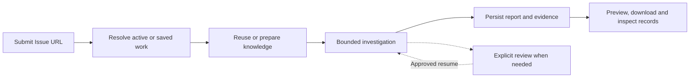

# Roadmap

[Documentation](README.md) · [Architecture](ARCHITECTURE.md)

MaintainerLens V1 provides a public, read-only **Issue URL → investigation report**
workflow. The V1 scope below describes implemented behavior, not a claim of
universal report accuracy or a tagged `1.0.0` package release. Retrieval/report
quality will continue improving independently of basic workflow availability.

## V1 — Implemented workflow

| Area | Implemented in V1 |
| --- | --- |
| Deployment | Docker Compose builds frontend/backend, runs Alembic and starts five long-running services |
| Web workspace | English-first EN/中文 interface, URL submission, progress, Markdown preview/copy/download |
| Reliable delivery | Transactional Outbox, confirmed RabbitMQ publication, finite retries/dead-letter handling |
| Task ownership | Atomic claims, renewable leases, claim-token fencing and generation-aware recovery |
| Source knowledge | Public commit-pinned indexing, file allowlists, syntax-aware/text chunking, pgvector and optional literal/RRF retrieval |
| History knowledge | Bounded public Issue/PR/comment ingestion, persisted embeddings and retrieval |
| Automatic preparation | Reuse compatible knowledge and build missing configured knowledge without a manual Source UUID |
| Investigation | Modular LangGraph, structured analysis, model-selected search tools, deduplication and up to three rounds |
| Output safeguards | Full execution deadlines, cancellation cleanup, actual-context citation validation and one bounded schema-correction call |
| Persistence | Issue snapshots, validated results, actual analysis excerpts, derived Markdown and durable Graph progress |
| Repeated URL handling | Active-task reuse, scoped freshness, updated investigations and up to three eligible user recoveries |
| Human decisions | Preparation/output-limit review, explicit budget continuation, eligible complete-stage acceptance or rejection |
| Operations | Safe phases/errors, Task ID/URL lookup, bounded Docker diagnostic logs |
| Verification | Offline provider/Graph tests, PostgreSQL/RabbitMQ integration, browser tests and opt-in deployed URL acceptance |

### What V1 deliberately does not do

- Modify a repository, execute its code/tests, push commits or open repair PRs.
- Require human approval for every normal report.
- Provide an authenticated multi-user/private-repository service.
- Offer a continuous chat with trusted cross-turn project memory.
- Guarantee complete repository/history coverage, verified root causes, a fixed
  monetary cost or a measured high-availability SLA.

Syntax-aware coverage and text-only formats are distinguished in
[supported languages](SUPPORTED_LANGUAGES.md). Operational success and semantic
report quality are evaluated separately in [report evaluation](REPORT_QUALITY.md).

## V1 — Continued improvement

These improvements can follow the initial public release without extending the
product into an automatic coding agent:

- Broader retrieval relevance labels and representative repository/language samples.
- Better evidence selection and report correctness, driven by recorded counterexamples.
- Clearer provider compatibility guidance and error diagnostics.
- Installation/documentation maintenance and regression coverage for reported defects.

Additional retrieval infrastructure, ranking stages or agent steps should follow
measured need rather than being prerequisites for running V1.

## V2 — Proposed directions

These are product directions, not implemented features or committed delivery dates.

### Issue-driven repair proposals with human approval

Extend an investigation into a concrete repair proposal: explain the change,
produce a reviewable patch and identify validation steps. Human approval must
precede applying changes or any future GitHub write action. Generated proposals,
executed tests and verified outcomes must remain distinguishable.

A branch/PR integration may follow only with explicit permissions, scoped
credentials, auditability and protections against duplicate/stale write actions.
V1's current human review controls execution budgets; it is not code-change approval.

### A continuous conversation with project memory

Evolve the UI into an investigation-linked conversation so developers can ask
follow-up questions, add reproduction details and refine a proposal without
restarting the entire interaction. Design explicit conversation storage and
trustworthy memory with provenance, revision scope, correction and expiry rules.

Existing RAG knowledge and Graph checkpoints are reusable foundations. They are
not an implemented chat history or trusted long-term conversational memory.

### Access and deployment foundations

Consider private-repository authentication, identity/tenant isolation and
controlled shared deployment alongside the conversational/repair workflow.
Provider credentials, repository permissions and human decisions must stay
scoped to the appropriate user and project.

## Contribution priorities

Reproducible installation/workflow bugs, actionable retrieval/report failures,
provider compatibility reports and clearer documentation are useful contributions.
Include Task ID, versions and sanitized evidence where possible; do not publish
keys or private data. See [development and contributing](DEVELOPMENT.md).
